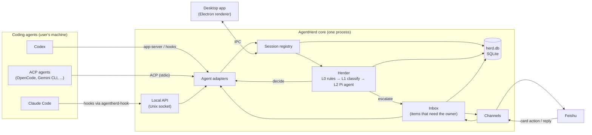

# 02. Architecture

Applied ADRs: [0003](../adr/0003-herder-on-pi-agent-core.md), [0004](../adr/0004-electron-app-with-headless-core.md),
[0005](../adr/0005-channel-abstraction-feishu-first.md), [0006](../adr/0006-agent-adapters-attach-and-launch.md),
[0010](../adr/0010-typescript-pnpm-monorepo.md).

## 1. Overview



The flow for one event:

1. An agent reaches a point that needs a decision, for example a permission prompt.
2. The adapter for that agent turns the raw signal into an `AgentEvent` (see
   [03-agent-adapters.md](03-agent-adapters.md#3-normalized-events)).
3. The session registry updates the session state.
4. If the event needs a decision, the Herder runs its pipeline
   ([04-herder.md](04-herder.md)). The result is a `Decision`.
5. If the decision is final and the mode allows it, the adapter applies it to the agent.
6. Otherwise the event becomes an **item** in the inbox. The inbox sends it to the owner
   through the active channel and waits.
7. The owner's answer goes back through the adapter. The pair (item, answer) goes into
   decision memory.

## 2. Processes

| Process | What runs there | Notes |
| --- | --- | --- |
| Electron main | Window, tray, auto-update, OS keychain, starts the core | Thin. No business logic. |
| Core (Electron `utilityProcess`) | Local API, adapters, registry, Herder, inbox, channels, store | Plain Node code. Must also run without Electron (tests, future headless mode). |
| Renderer | Desktop UI | Talks to main through a typed preload bridge only. No Node access. |
| `agentherd-hook` | Short-lived process started by an agent hook | Forwards one event to the core and prints the agent-specific answer. |
| Launched agents | Agents that AgentHerd starts (launch mode) | Child processes of the core. |

The core is the only process that holds state. The renderer and the hook bridge are clients.

## 3. Packages

```text
apps/
  desktop/              Electron main, preload, renderer
packages/
  protocol/             Shared types and schemas: AgentEvent, Decision, Item, local API messages
  core/                 Registry, Herder pipeline, inbox, store, local API server
  hook/                 agentherd-hook CLI (no runtime dependencies besides Node)
  adapter-claude-code/
  adapter-codex/
  adapter-acp/
  adapter-mock/         Scripted fake agent for development and E2E tests
  channel-feishu/
```

Rules:

- `protocol` depends on nothing in the repo.
- `core` depends on `protocol` only. Adapters and channels register through interfaces.
- Adapters and channels depend on `protocol`, never on each other.
- `apps/desktop` composes everything.

## 4. Local API

- Transport: a Unix domain socket at `~/.agentherd/run/herd.sock` (a named pipe on
  Windows). File mode `600`. No TCP port.
- Framing: newline-delimited JSON. Each message has `v` (protocol version), `id`, `type`.
- Main messages:
  - `event.report` (hook → core): one raw agent event. The reply is the decision, or
    `defer` when the hook must let the agent ask on its own.
  - `session.list`, `session.watch` (desktop → core).
  - `item.list`, `item.resolve` (desktop → core).
- The hook waits for at most `hookTimeoutMs` (default 600 000 ms, configurable per
  adapter). On timeout or on any error it returns `defer`.

## 5. Storage

All state is under `~/.agentherd/` (overridable by `AGENTHERD_HOME`):

| Path | Content |
| --- | --- |
| `config.json` | Settings without secrets |
| `herd.db` | SQLite: sessions, events, items, decisions, rules |
| `run/herd.sock` | Local API socket |
| `logs/` | Rotated logs. Secrets redacted. |
| `bin/agentherd-hook` | Hook bridge installed by the desktop app |

Secrets (Feishu App Secret, model API keys) are stored with Electron `safeStorage`
(OS keychain). They are never written to `config.json`, logs or `herd.db`.

## 6. What a supervised session costs

- Attach mode adds one short process start per hook call. Most hook calls (tool calls that
  need no decision) are not routed to AgentHerd at all; only the hooks listed in
  [03-agent-adapters.md](03-agent-adapters.md) are installed.
- The Herder calls a model only for L1 and L2. L0 rules cost nothing.

## 7. Keep running with the lid closed

Applied ADR: [0011](../adr/0011-keep-running-with-lid-closed.md). macOS only in v1.

| Setting | Default | Meaning |
| --- | --- | --- |
| `keepAwake` | `false` | Opt-in switch in the tray and settings |
| `keepAwakeIdleMinutes` | `15` | Restore normal sleep after this long with no active session |
| `keepAwakeMinBattery` | `20` | On battery, restore normal sleep below this percent |

Rules:

- Before the first change, save the current `disablesleep` value in `config.json`.
- Restore it when the switch is turned off, on idle, at the battery floor, on quit, and on the
  next start after a crash.
- The tray icon shows when keep-awake is on.
- Every change and restore is logged, and the channel gets a short notice when keep-awake
  stops for battery.
