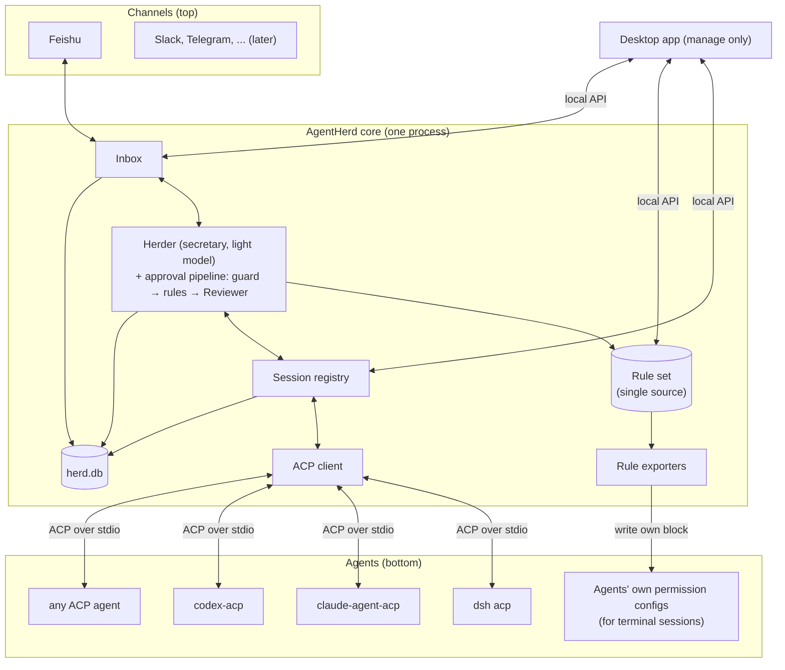

# 02. Architecture

Applied ADRs: [0003](../adr/0003-herder-on-pi-agent-core.md), [0004](../adr/0004-electron-app-with-headless-core.md),
[0005](../adr/0005-channel-abstraction-feishu-first.md), [0010](../adr/0010-typescript-pnpm-monorepo.md),
[0015](../adr/0015-acp-is-the-only-runtime-protocol.md), [0016](../adr/0016-one-rule-source-exported-to-agents.md).

## 1. Layers



- **Top:** channels. The core never names a chat app ([05-channels.md](05-channels.md)).
- **Middle:** the core. One rule set, one Herder, one inbox.
- **Bottom:** agents, reached in two ways ([03-agents.md](03-agents.md)):
  - **ACP runtime** for sessions AgentHerd starts. This is the only runtime protocol.
  - **Rule export** for sessions the user starts outside AgentHerd. Exporters only write
    config files; they do not run agents.

The flow for one permission request on the ACP path:

1. The agent sends `session/request_permission`.
2. The registry records it as an item and updates the session state.
3. The Herder runs its pipeline ([04-herder.md](04-herder.md)) and returns a `Decision`.
4. If the decision is final and the mode allows it, the ACP client answers the request.
5. Otherwise the inbox sends the item to the owner through the channel and waits.
6. The owner's answer goes back as the ACP response. The pair (item, answer) goes into
   decision memory.

## 2. Processes

| Process | What runs there | Notes |
| --- | --- | --- |
| Electron main | Window, tray, auto-update, OS keychain, keep-awake, starts the core | Thin. No business logic. |
| Host (Electron `utilityProcess`, or `agentherd start`) | ACP client, registry, Herder, inbox, channels, exporters, store, local API | Plain Node code (`packages/host` composes `core`). Must also run without Electron (tests, CLI). One host per `AGENTHERD_HOME`; the app connects to a running one. |
| Renderer | Desktop UI | Talks to main through a typed preload bridge only. No Node access. |
| Agent processes | One per ACP session group, started from a profile command | Children of the core. |

The core is the only process that holds state.

## 3. Packages

```text
apps/
  desktop/              Electron main, preload, renderer
packages/
  protocol/             AgentHerd types and schemas: Item, Decision, Rule, local API messages
  core/                 Registry, Herder, inbox, store, local API server
  acp-client/           Starts agents from profiles, maps ACP to registry events and back
  herder/               Herder: tools, prompts, per-event context, ModelClient
  herder-loop/          Agent loop forked from Pi (ADR 0020); UPSTREAM.md tracks the base
  rules/                Rule model, matcher, guard list, command normalization
  exporter-claude-code/ exporter-codex/ exporter-gemini/ exporter-opencode/
  channel-feishu/       Feishu channel: one-scan setup, long connection, cards
  channel-fake/         In-memory channel for tests; plays the owner
  mock-agent/           Scripted fake ACP agent for development and E2E tests
  host/                 Composes core, Herder, channel and keychain; serves the local API
  cli/                  `agentherd` development CLI: setup feishu, model, run, start, status
```

Rules:

- `protocol` and `rules` depend on nothing in the repo except `protocol`.
- `core` depends on `protocol`, `rules` and `acp-client`. Channels and exporters register
  through interfaces.
- Channels and exporters depend on `protocol` and `rules`, never on each other.
- ACP types come from `@agentclientprotocol/sdk` and are used only inside `acp-client`.
- `apps/desktop` composes everything.

## 4. Local API

- Used by the desktop app and the CLI. Agents do not use it.
- Transport: a Unix domain socket at `~/.agentherd/run/herd.sock`, file mode `600`, in a
  directory with mode `700`. No TCP port.
- Framing: newline-delimited JSON. Each message has `v` (protocol version), `id`, `type`.
- Calls are `{v, id, type:"call", method, params}`, answers `{v, id, type:"result", ok,
  result|error}`, pushes `{v, type:"event", event:{topic, data}}` (`packages/host/src/api.ts`).
- Methods now (plan 011): `status`, `tasks` (tasks and open items, read-only; owners decide in
  the channel), `providers`, `models`, `putService`, `removeService`, `setKey`, `chooseModel`,
  `testModel`, `setupFeishu`, `cancelSetup`, `setupState`, `updateSettings`. Later: `rule.*`,
  `export.*`.

## 5. Storage

All state is under `~/.agentherd/` (overridable by `AGENTHERD_HOME`):

| Path | Content |
| --- | --- |
| `config.json` | Settings and agent profiles, without secrets |
| `herd.db` | SQLite: sessions, items, decisions, rules |
| `run/herd.sock` | Local API socket |
| `logs/` | Rotated logs. Secrets redacted. |
| `backups/` | Copies of agent config files before each export |

Secrets (Feishu App Secret, model API keys) are stored in `<home>/secrets.json` (mode 600, in
the mode 700 home), keyed `feishu:<appId>` and `model:<serviceId>`. Not the macOS keychain: the
owner did not want them there, and its per-program access prompts appeared every time a different
binary (node, Electron) read an item. The host process holds them, so the desktop app and the CLI
share them; the renderer and
Electron main never see a key after it is saved (plan 011). They are never written to
`config.json`, logs or `herd.db`.

Display preferences of one screen stay in the desktop app's `localStorage`, not in the home:
the font size (设置 → 字体大小, `agentherd.fontScale`, 90%–130%; it scales every text size and
line height, not spacing or icons) and whether the first run ran.

All TypeScript is erasable syntax only (`erasableSyntaxOnly`), so Node runs the sources
directly with type stripping; there is no build step for packages.

## 6. Cost

- ACP sessions cost one agent process each, as they would without AgentHerd.
- Rule export costs nothing at run time; the agent enforces its own config.
- The Reviewer calls a model only for items that pass the guard list and rules; the guard
  list and rules cost nothing. The Herder calls its light model only for direct messages,
  ended tasks, watchdog alarms and the digest.

## 7. Keep running with the lid closed

Applied ADR: [0011](../adr/0011-keep-running-with-lid-closed.md). macOS only in v1.

| Setting | Default | Meaning |
| --- | --- | --- |
| `keepAwake` | `false` | Opt-in switch in the tray and settings |
| `keepAwakeIdleMinutes` | `15` | Restore normal sleep after this long with no active session |
| `keepAwakeMinBattery` | `20` | On battery, restore normal sleep below this percent |

Rules:

- Before the first change, save the current `disablesleep` value in `config.json`.
- Restore it when the switch is turned off, on idle, at the battery floor, on quit, and on the
  next start after a crash.
- The tray icon shows when keep-awake is on.
- Every change and restore is logged, and the channel gets a short notice when keep-awake
  stops for battery.
