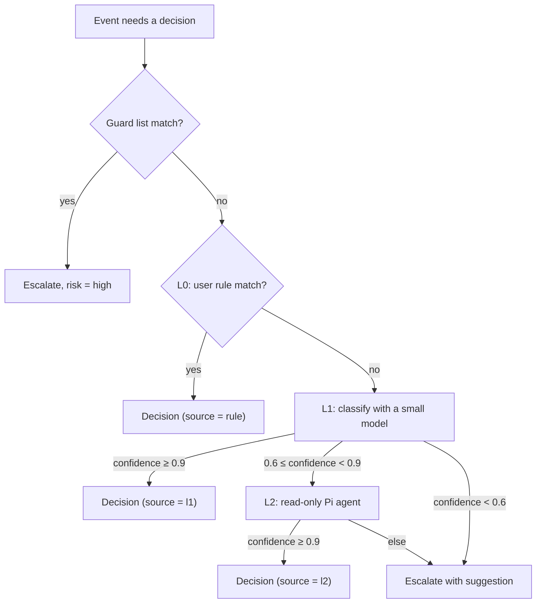

# 04. Herder

Applied ADRs: [0003](../adr/0003-herder-on-pi-agent-core.md), [0007](../adr/0007-tiered-decisions-fail-open-to-human.md),
[0008](../adr/0008-observe-first-rollout.md).

The Herder is the part of AgentHerd that decides. It is not a long-running chat agent. It is
an event-driven pipeline: one event in, one decision out. It keeps no conversation between
events; context comes from the session summary and decision memory.

## 1. Inputs and output

Input for one event:

- the `AgentEvent` that needs a decision;
- a short summary of the session (task, recent turns, files changed), at most 2 000 tokens;
- up to 5 past decisions from memory that look similar;
- the rule set and the current mode and presence.

Output:

```ts
interface Decision {
  itemId: string;
  action: "allow" | "deny" | "answer" | "continue" | "escalate" | "defer";
  text?: string;           // the answer, or the instruction for "continue"
  confidence: number;      // 0..1; 1 for rules
  risk: "low" | "medium" | "high";
  source: "rule" | "l1" | "l2" | "human" | "timeout";
  reason: string;          // one sentence, shown to the user
  precedents: string[];    // ids of past decisions used
}
```

## 2. Pipeline



Thresholds are configuration; the values above are defaults.

### Guard list (always escalate)

Built in, can be extended, cannot be overridden by rules or models. Examples: recursive
delete outside the session's working directory, `git push --force` to a default branch,
piping a download into a shell, reading `~/.ssh`, keychains or `.env` files, changing
AgentHerd's own files or the agent's hook settings.

### L0: rules

A rule is a match plus an action. Match fields: agent kind, event type, tool name, command
pattern (glob on the normalized command), path scope (inside the session `cwd` or a listed
directory). Rules come from:

- the "Always do this" button on a card (the user confirms the generated match before it is saved);
- the desktop rule editor;
- import of the agent's own allowlist (for example Claude Code `permissions.allow`).

### L1: classify

One call to a small, cheap model with structured output. It returns category (read-only,
write inside cwd, network, install, destructive, secret access, outside cwd), risk, the
proposed action and confidence. It must name the precedents it relied on; a high-confidence
answer with no precedent is capped at 0.8 confidence.

### L2: read-only Pi agent

A Pi agent with read-only tools: read file, list, grep, `git status`, `git diff`, read the
session transcript. Budget per item: 8 tool calls, 60 seconds, a token limit set in
configuration. It cannot write files or run other commands. It is used when L1 is unsure.

## 3. Presence

Presence decides where human decisions go.

| Presence | Behavior |
| --- | --- |
| `desk` | The hook returns `defer`; the agent shows its own prompt in the terminal. The channel gets nothing unless the item waits longer than `deskTimeout` (default 5 min). |
| `away` | Items go to the channel. The hook waits for the answer. |

Presence is set from the tray, from the chat app ("I'm back"), or by idle detection
(no keyboard or mouse input for 10 minutes sets `away`). **(verify: whether a waiting
Claude Code hook still lets the user answer in the terminal.)**

## 4. Modes

| Mode | What AgentHerd applies by itself | Use |
| --- | --- | --- |
| `observe` | Nothing. It records its suggestion and later compares it with the real answer. | Default for a new install. Builds the agreement metric. |
| `assist` | L0 rule decisions only | After the user has rules they trust |
| `auto` | L0, and L1/L2 decisions above threshold with risk `low` | After agreement ≥ 90% |

Mode can be set globally and overridden per project directory. The desktop app shows the
agreement metric next to the mode switch, so the user can see when `auto` is safe.

## 5. Decision memory

- Every item is stored with the final decision, who made it, and the suggestion the Herder
  made (also in `observe` mode).
- Similarity for precedents in v1: the same agent kind, the same tool, the same normalized
  command head (for example `pnpm test`, `git status`) and the same project. No embeddings in
  v1.
- The owner can mark any automatic decision as wrong. That lowers the weight of its
  precedents and offers a deny rule.
- An executed command cannot be undone. "Undo" means: remove the rule, mark the precedent
  wrong, and tell the agent in the next turn if it is still running.

## 6. Loop detection

The registry marks a session `looping` when one of these happens:

- the same tool call with the same arguments 3 times in one turn;
- 3 `turn.stopped` events in a row with no file change and almost the same last message;
- `working` for longer than `maxQuietMinutes` (default 30) with no new event.

A looping session becomes a notification item, not a decision. The owner can tell the
agent to stop or give it an instruction.

## 7. Model provider

The Herder uses the model the user configures (any provider Pi supports). Suggested
defaults: a fast model for L1 (for example DeepSeek V4 Flash) and a stronger model for L2
(for example DeepSeek V4 Pro). Without a model, AgentHerd still works with guard list, rules
and the human.
