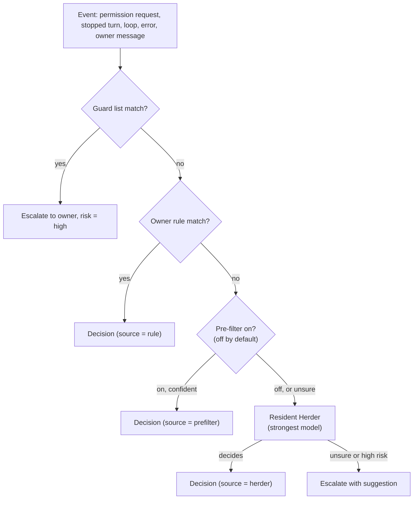

# 04. Herder

Applied ADRs: [0003](../adr/0003-herder-on-pi-agent-core.md), [0007](../adr/0007-tiered-decisions-fail-open-to-human.md),
[0008](../adr/0008-observe-first-rollout.md), [0012](../adr/0012-channel-is-the-only-decision-surface.md),
[0017](../adr/0017-resident-herder-per-project.md).

The Herder is the supervisor. There is **one resident Herder per project directory**: a Pi
agent session that runs the strongest model the user picked, keeps the project's context
across events, and manages the agent sessions working in that project. It does not write
code itself; the agents do.

Cheap, deterministic checks run before it, so most events never reach the model.

## 1. Pipeline



Thresholds are configuration. Events of the same project are delivered to its Herder in
order; events that arrive while it is busy are batched into its next turn.

### Guard list (always escalate)

Built in, can be extended, cannot be overridden by rules or models. It applies to agent
requests **and to the Herder's own actions**. Examples: recursive delete outside the session's
working directory, `git push --force` to a default branch, piping a download into a shell,
reading `~/.ssh`, keychains or `.env` files, changing AgentHerd's own files or the agents'
permission configs.

### L0: rules

A rule is a match plus an action. Match fields: agent profile, event type, tool name, command
pattern (glob on the normalized command), path scope (inside the session `cwd` or a listed
directory). Rules come from:

- the "Always do this" button on a card. The generated rule is scoped to the session's project
  directory by default; the owner can widen it later in the desktop rule editor;
- the desktop rule editor.

### Pre-filter (optional, off by default)

One call to a small, cheap model with structured output: category, risk, proposed action and
confidence. It may decide only `low` risk items with confidence ≥ 0.9 and a named precedent;
everything else goes to the Herder. It exists to save cost for users who want it.

## 2. The resident Herder

### Context

The Herder's session holds, per project:

- the open tasks and the agent sessions working on them (state, last report, files changed);
- recent decisions and the owner's answers (decision memory, [§5](#5-decision-memory));
- the rule set and the current mode;
- the project's own instructions (`AGENTS.md` / `CLAUDE.md`, if present).

Agent output in events is untrusted data. It is quoted, and it cannot change rules, mode or
the Herder's instructions ([06-security.md](06-security.md)). The session is compacted when it
grows past a configured budget; a compaction keeps open tasks, open items and unresolved
owner instructions verbatim.

### Tools

| Group | Tools | Notes |
| --- | --- | --- |
| Decide | `decide(itemId, action, text?, reason)` | Answers a pending item |
| Manage agents | `session_prompt` (continue, steer), `session_cancel`, `session_start` (new task in this project), `session_list` | Goes through the ACP client |
| Talk to the owner | `escalate(itemId, suggestion)`, `notify(text)` | Through the inbox and channel |
| Read | `read`, `grep`, `list`, `git_diff`, `git_log`, `session_transcript` | Inside the project directory only |

The Herder has no tool to write files or run arbitrary shell commands. Every tool call it
makes is checked by the guard list first; a match escalates to the owner instead of running.
Every tool call is written to the audit log.

### Output

```ts
interface Decision {
  itemId: string;
  action: "allow" | "deny" | "answer" | "continue" | "escalate";
  text?: string;           // the answer, or the instruction for "continue"
  confidence: number;      // 0..1; 1 for rules
  risk: "low" | "medium" | "high";
  source: "rule" | "prefilter" | "herder" | "human";
  reason: string;          // one sentence, shown to the owner
  precedents: string[];    // ids of past decisions used
}
```

### Lifecycle

- A project's Herder starts with the first session in that project and stops after
  `herderIdleMinutes` (default 60) with no open sessions or items. Its context is saved and
  reloaded on the next start.
- If the Herder fails (model error, timeout, invalid output), pending items escalate to the
  owner. It never turns a failure into `allow`.
- Like the Watchdog in dsh-superagent, the Herder also handles loops and agent errors
  ([§6](#6-loop-detection)).

## 3. Where human decisions go

Applied ADR: [0012](../adr/0012-channel-is-the-only-decision-surface.md).

- Every escalated item goes to the channel. There is no "at the desk" state; the desktop app
  manages AgentHerd but is not where the owner answers.
- The item waits for the owner. A reminder is sent every `remindMinutes` (default 30) while
  it is open. AgentHerd never decides for the owner because time passed.
- If the channel is disconnected, the item stays in the inbox, shows in the desktop app, and
  is sent when the channel reconnects. The agent keeps waiting.
- Sessions started outside AgentHerd never reach the Herder; they follow exported rules and
  ask in their own UI ([03-agents.md](03-agents.md#2-rule-export)).

## 4. Modes

| Mode | What AgentHerd applies by itself | Use |
| --- | --- | --- |
| `observe` | Nothing. It records its suggestion and later compares it with the real answer. | Default for a new install. Builds the agreement metric. |
| `assist` | L0 rule decisions only | After the user has rules they trust |
| `auto` | L0, and pre-filter / Herder decisions above threshold with risk `low` or `medium` | After agreement ≥ 90% |

Mode can be set globally and overridden per project directory. The desktop app shows the
agreement metric next to the mode switch, so the user can see when `auto` is safe.

## 5. Decision memory

- Every item is stored with the final decision, who made it, and the suggestion the Herder
  made (also in `observe` mode).
- Similarity for precedents in v1: the same agent kind, the same tool, the same normalized
  command head (for example `pnpm test`, `git status`) and the same project. No embeddings in
  v1.
- The owner can mark any automatic decision as wrong. That lowers the weight of its
  precedents and offers a deny rule.
- An executed command cannot be undone. "Undo" means: remove the rule, mark the precedent
  wrong, and tell the agent in the next turn if it is still running.

## 6. Loop detection

The registry marks a session `looping` when one of these happens:

- the same tool call with the same arguments 3 times in one turn;
- 3 `turn.stopped` events in a row with no file change and almost the same last message;
- `working` for longer than `maxQuietMinutes` (default 30) with no new event.

A looping session or an agent error goes to the Herder first. It may steer the agent, cancel
the turn, or escalate. In `observe` mode it only suggests.

## 7. Model provider

- The user picks the provider and model during onboarding, from the providers Pi supports.
  AgentHerd ships no default provider. The onboarding page recommends the strongest model the
  user has access to for the Herder, and a cheap one if the pre-filter is turned on.
- The model step can be skipped. Without a model, AgentHerd works with the guard list, rules
  and the owner; the Herder is off.
